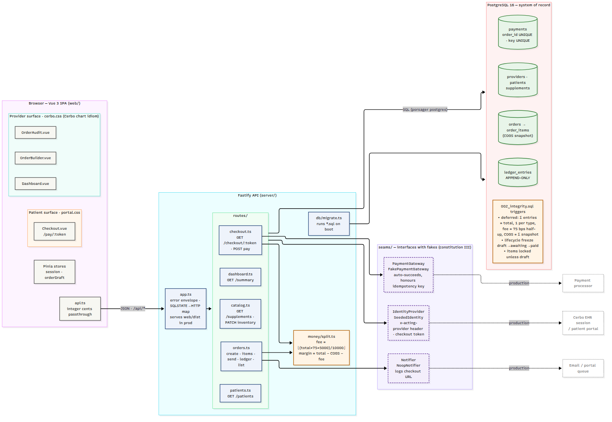
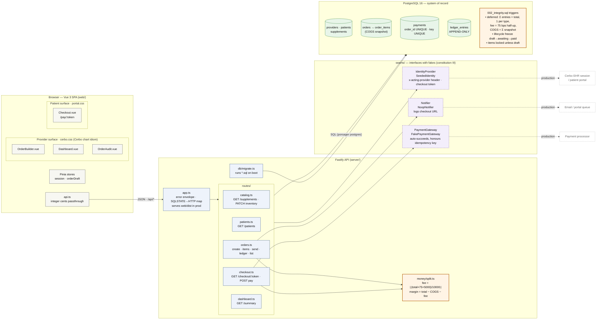
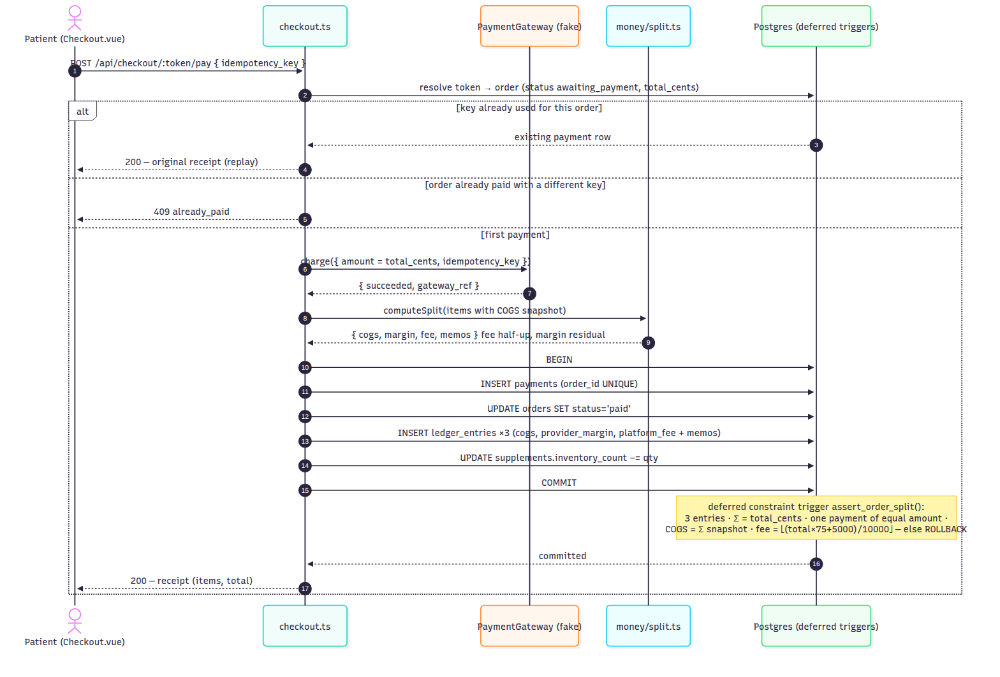
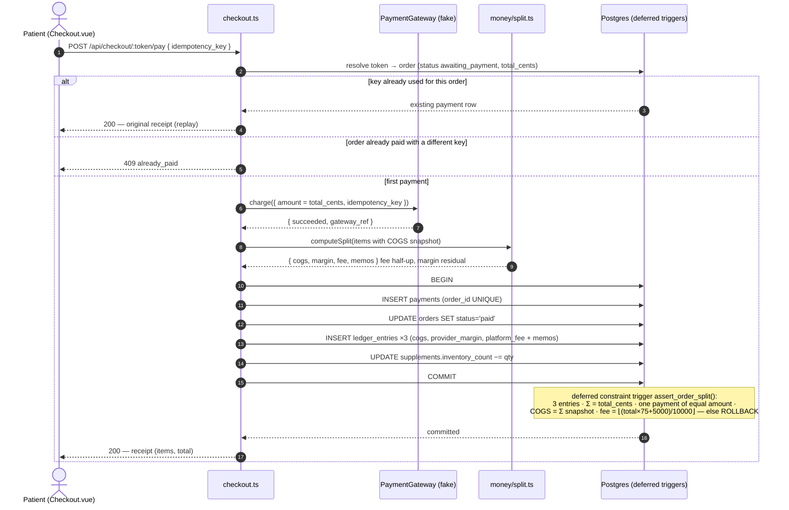
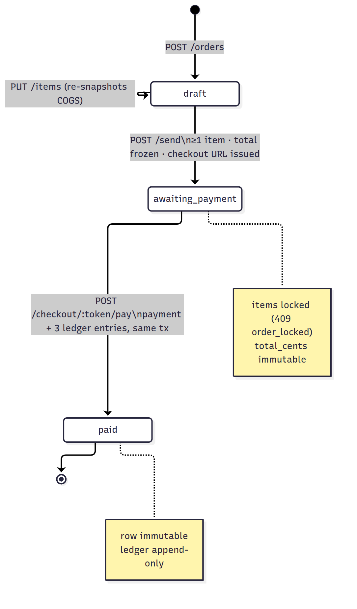
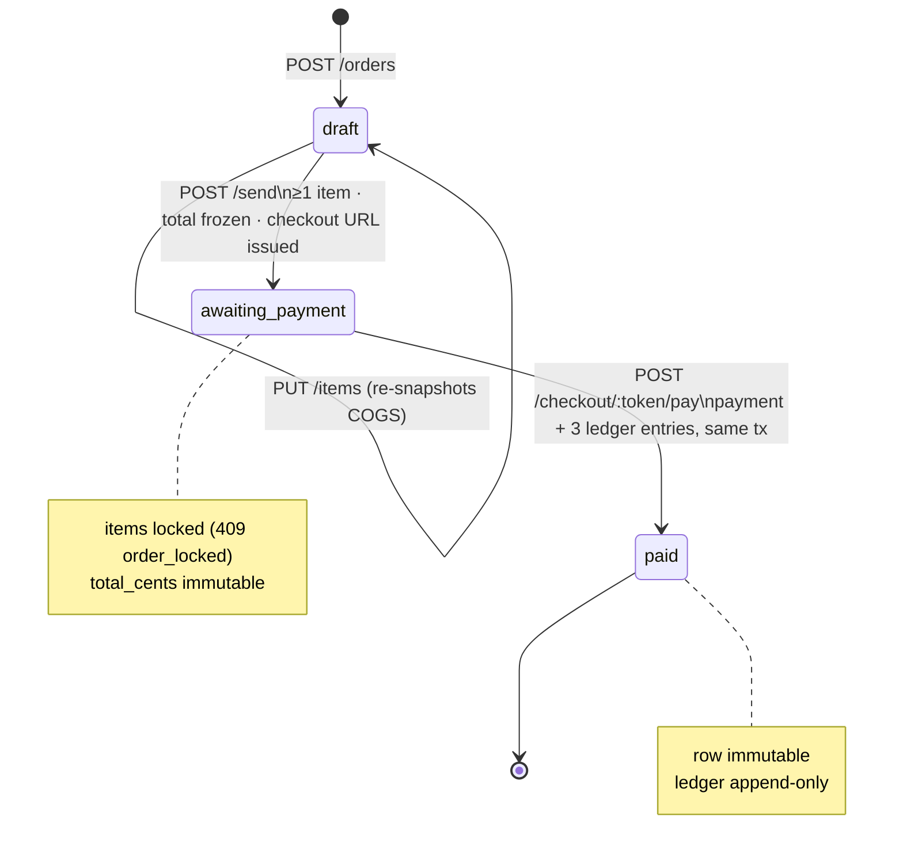
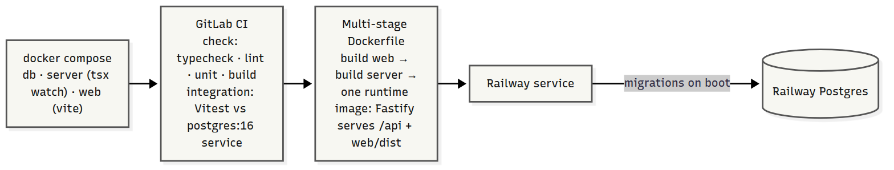
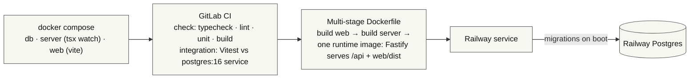

# Architecture

Vertical slice of an in-house supplement store that "lives inside" Cerbo's EHR. One Vue 3 SPA
with two visual surfaces, one Fastify REST API, one Postgres database that is the system of record
for money. Everything external is behind a documented seam with a fake implementation.

Companion documents: [KEY_METRICS.md](KEY_METRICS.md) (what we measure and how it's derived from
the ledger) and [SCALING.md](SCALING.md) (what breaks at 10 → 100 000 users and what changes).

## Contents

1. [System overview](#system-overview)
2. [Request flows](#request-flows) — assemble, send, pay, audit, dashboard
3. [Data model and consistency](#data-model-and-consistency)
4. [Security and privacy model](#security-and-privacy-model)
5. [Tenancy](#tenancy) — how this fits Cerbo's per-practice deployment
6. [Operability](#operability) — config, migrations, health, logs, CI/CD
7. [Deployment](#deployment)
8. [Where things live](#where-things-live)
9. [Glossary](#glossary)

## System overview

## Request flows

Every provider route resolves the acting provider through the identity seam (header today, EHR
session in production) and scopes every query by `provider_id`. Every patient route resolves a
capability token (checkout token per order, portal token per patient). No route trusts an id
from the client without that scoping.

| Flow | Route(s) | Transaction shape | Enforced by |
|---|---|---|---|
| Assemble | `POST /orders`, `PUT /orders/:id/items` | one tx per PUT: delete lines, insert lines; COGS snapshot taken by trigger | `order_items_guard` (draft only, snapshot), `orders_guard_insert` (patient ∈ provider) |
| Send | `POST /orders/:id/send` | one `UPDATE … WHERE status='draft'`; notifier runs after commit, best-effort | `orders_guard_transition` (≥1 line, total frozen); API answers 409 on repeat |
| Pay | `POST /checkout/:token/pay` | one tx: `SELECT … FOR UPDATE`, gateway charge, payment row, status → paid, 3 ledger rows, stock decrement | deferred `assert_order_split()` at COMMIT; `payments.order_id UNIQUE`; row lock serialises races |
| Audit | `GET /orders/:id/ledger` | read-only | 409 unless paid; reads the ledger, never recomputes |
| Reporting | `GET /dashboard/summary` | one `REPEATABLE READ READ ONLY` tx, two reads | sums over `ledger_entries`, so tiles ≡ Σ audits; per provider |
| Inventory | `GET /inventory`, `PATCH /supplements/:id/inventory` | read-only / single UPDATE | practice-wide (shared stock); `units_sold_mine` is the only provider-scoped field |
| Portal | `GET /portal/:token` | read-only | token → patient; invoices and messages scoped to that patient |

## The money path (US2: patient pays)

One request, one database transaction, verified at commit by the database itself. The gateway
call sits inside the transaction because the shipped gateway is a synchronous fake; see README →
"The payment boundary, honestly" for what changes with a real processor (pending row, call
outside the lock, webhook reconciliation).

## Data model and consistency

Seven tables (see [docs/data-model](specs/001-supplement-store/data-model.md) for columns):
`providers`, `patients`, `supplements`, `orders`, `order_items`, `payments`, `ledger_entries`,
plus `notifications` (portal messages / email nudges). Every money column is `BIGINT` cents.

**Source of truth per concern**

| Concern | Truth | Derived copies |
|---|---|---|
| What the patient owes / paid | `orders.total_cents` (frozen at send), `payments.amount_cents` | builder preview (client mirror), checkout view |
| Where each cent went | `ledger_entries` (append-only) | audit view, dashboard sums, per-order rows in `GET /orders/:id` |
| Cost basis of a sold unit | `order_items.unit_cogs_cents` (snapshot) | the catalog's `unit_cogs_cents` is *current* cost, not history |
| Stock | `supplements.inventory_count` (practice-wide; its own screen, not part of the per-provider report) | `units_sold` / `units_sold_mine` are recomputed from paid order lines |

**Consistency model.** All writes are single-transaction and the database holds the invariants:

- *Lifecycle*: `draft → awaiting_payment → paid`, no other transitions, enforced by `BEFORE UPDATE`
  trigger; a paid order and its lines are immutable; history tables refuse `TRUNCATE`.
- *Split invariant*: a `DEFERRABLE INITIALLY DEFERRED` constraint trigger fires from `payments`,
  `orders` (on → paid) and `ledger_entries`, and at COMMIT asserts: exactly one entry per type, sum
  = total, one payment of equal amount referenced by all entries, COGS = Σ snapshots, fee = policy.
- *Idempotency*: `payments.idempotency_key UNIQUE` and `payments.order_id UNIQUE`; the pay route
  locks the order row so concurrent replays serialise and return the original receipt.
- *Reads*: dashboard reads share one snapshot; everything else is single-statement.

What is **not** guaranteed and why: stock is not reserved at send (an order can oversell; flagged,
not blocked — DECISIONS #12); notifications are best-effort after commit (an outbox would make
them transactional — HDX-89); the gateway call sits inside the pay transaction because the fake
is synchronous (a real processor moves it out — README → "The payment boundary, honestly").

## Security and privacy model

- **Identity**: provider = `x-acting-provider` header (stand-in for the EHR session); patient =
  32-hex capability token per order (`/pay/<t>`) and per patient (`/portal/<t>`), 122 bits of
  entropy, generated by Postgres. Tokens do not expire in this slice; production would use the
  portal session or signed, expiring links.
- **Authorisation**: every provider query is scoped by `provider_id`; cross-provider access returns
  404, not 403 (no existence leak). Patient views omit COGS, margin, fee (DECISIONS #7).
- **Card data**: the number never leaves the browser. A fake tokenizer sends `{token, brand,
  last4}`; only brand and last four are stored. The real version is Stripe Elements or equivalent
  (PCI SAQ-A scope).
- **Input validation**: Zod on every body; integer-cent bounds; duplicate line detection.
- **Database privileges**: `UPDATE/DELETE/TRUNCATE` revoked on the ledger and history tables in
  addition to triggers. The deployed role is still the owner (superuser on Railway's Postgres), so
  this is defence in depth; a least-privilege app role is listed in SCALING.md.
- **Not in scope**: real authentication, CSRF (no cookies today), rate limiting, PHI handling
  beyond "don't leak the split to the patient". See SCALING.md for where each lands.

## Tenancy

Cerbo's public API is addressed per practice: `https://{tenant}.md-hq.com/api/v1/` with API
credentials per practice (docs.cer.bo). Whether each tenant is a separate deployment or one shared
application routed by subdomain is not public. This slice is tenancy-neutral:

- Rows are already scoped by `provider_id`, and `patients.provider_id` pins each patient to one
  practice. Adding a `practice_id` (tenant) column to `providers`, `supplements`, `orders` and
  `notifications`, plus a composite index and row-level security, turns the same schema into a
  shared multi-tenant one.
- Per-tenant instances need no schema change: deploy the image per practice with its own
  `DATABASE_URL`, exactly as the Railway deploy does now.

SCALING.md discusses which model makes sense at each size.

## Operability

- **Configuration**: environment only (`DATABASE_URL`, `PORT`, `PUBLIC_WEB_ORIGIN`, `LOG_LEVEL`,
  `STATIC_DIR`); `server/src/config.ts` is the single reader.
- **Migrations**: forward-only `.sql` files applied on boot under a transaction-scoped advisory
  lock; `schema_migrations` records them; `/api/health` reports the count and latest file.
- **Logging**: Fastify/pino JSON; 5xx responses log the underlying error; DB rejections are mapped
  to typed error codes (`CB001`–`CB004` → HTTP) so clients and logs share a vocabulary.
- **CI/CD**: GitLab CI runs typecheck, lint, format, unit (server + web) and integration (real
  Postgres service) on every push; on `main` it then deploys to Railway and curls `/api/health`.
- **Tests**: 20 server unit, 37 web unit, 60 integration (throwaway database per file), plus a
  headless-browser script for the full user journey.

## Order lifecycle (enforced by `orders_guard_transition`)

## Deployment

## Where things live

| Concern | Location |
|---|---|
| Fee policy (75 bps half-up) | `server/src/money/split.ts` **and** `002_integrity.sql` §2f (cross-check, DECISIONS #8) |
| Sum invariant | `002_integrity.sql` `assert_order_split()` — deferred constraint trigger |
| Append-only ledger | `002_integrity.sql` §1 — trigger + REVOKE |
| COGS snapshot | `order_items_guard` trigger copies from catalog on insert (DECISIONS #9) |
| Stubbed boundaries | `server/src/seams/*.ts` — header comment on each states what is faked and what production does |
| Provider look | `web/src/styles/cerbo.css` per `docs/cerbo-ui-reference/DESIGN-NOTES.md` |
| Patient look | `web/src/styles/portal.css` |

PNGs are rendered from the Mermaid blocks above with `@mermaid-js/mermaid-cli`; the Mermaid source is canonical.

## Glossary

Domain and engineering terms used across the code, specs, and decision log.

**Money and accounting**

| Term | Meaning here |
|---|---|
| **COGS** (cost of goods sold) | What Cerbo paid for one unit of a supplement. Stored on the catalog as `unit_cogs_cents` and **snapshotted** onto each order line at assembly time, so later catalog changes never alter historical orders. |
| **bps** (basis points) | One hundredth of a percent. 75 bps = 0.75 % = 75 ⁄ 10 000. Used because fee schedules are quoted this way and it keeps the arithmetic in integers. |
| **Platform fee** | Cerbo's cut: 75 bps of the order total, computed once per order and rounded half-up. Borne by the provider's margin, so the patient pays sticker price. |
| **Provider margin** | What the provider earns: `total − COGS − platform fee`. Computed as the residual so the three parts always sum exactly. May be negative if the provider prices below cost. |
| **Split** | The three-way attribution of a paid order's total into COGS, provider margin, and platform fee. The graded heart of this project. |
| **Sum invariant** | The rule `COGS + provider margin + platform fee = amount paid`, with no exceptions. Enforced by the database at commit, not only by application code. |
| **Ledger / ledger entry** | The append-only table (`ledger_entries`) that records the split. One row per component per paid order. The system of record for money. |
| **Append-only** | Rows can be inserted but never updated or deleted. Enforced by a trigger and by revoked privileges. |
| **Compensating entry** | The only way to "correct" an append-only ledger: a new row that offsets an earlier one. Out of scope for this slice (no refunds), but the schema leaves room for it. |
| **Integer cents** | All money is stored and computed as whole cents in 64-bit integers (`BIGINT`, JS `number` guarded by `Number.isSafeInteger`). No floats, no decimal strings doing arithmetic. |
| **Half-up rounding** | When the exact fee lands on a fraction of a cent, .5 and above rounds up, below .5 rounds down. Implemented as `floor((total × 75 + 5000) / 10000)`. Example: 200 ¢ → 1.5 ¢ → 2 ¢. |
| **Memo** | A human-readable note stored on each ledger entry showing the computation, e.g. `75 bps of 7250¢ = 54.375¢ → 54¢ (half-up)`. Lets a reviewer audit the split without reading code. |
| **GMV** (gross merchandise value) | Total value of orders processed through the store. The brief's headline business metric; the dashboard's "gross" tile. |
| **Gross / margin / fees** (dashboard) | Sums over ledger entries: gross = Σ totals of paid orders, margin = Σ provider_margin entries, fees = Σ platform_fee entries. Computed from the ledger so they reconcile structurally. |

**Order flow**

| Term | Meaning here |
|---|---|
| **Order lifecycle** | `draft → awaiting_payment → paid`. Only these transitions exist. |
| **Draft** | Editable by the provider: items can be added, repriced, removed. No total yet. |
| **Awaiting payment** | "Sent" to the patient. Items and total are frozen; a checkout link exists. |
| **Paid** | Payment and ledger recorded. The order and its items are immutable. |
| **Frozen** | A column the database refuses to change after a given state (e.g. `total_cents` after send). |
| **Locked** | Same idea for whole rows: order items once the order leaves draft. The API returns `409 order_locked`. |
| **Snapshot** | A copy of a catalog value taken at a point in time and kept even if the catalog changes. Here: COGS on each order line. |
| **Default price** | The practice-level price on the catalog that pre-fills an order line. The provider can override it per line; the line is the source of truth. |
| **Checkout token / capability token** | A random, unguessable string on the order. Whoever holds the link can view and pay that one order. Stands in for a patient-portal session. |
| **Idempotency key** | A client-generated identifier sent with the pay request. Re-sending the same key returns the original result instead of charging twice. A different key on an already-paid order is rejected. |
| **Replay** | A repeated request with the same idempotency key (double-click, refresh, retry). Must be harmless. |
| **Receipt** | What the patient sees after paying: items and prices only. The margin breakdown is provider-facing. |

**Architecture and stubs**

| Term | Meaning here |
|---|---|
| **Seam** | A thin interface that separates this code from an external system, so the fake can be swapped for a real implementation without touching callers. Three here: identity, payment, notifier. |
| **Stub / fake** | The in-repo implementation of a seam that does the minimum to let the flow run (e.g. a payment gateway that always succeeds). |
| **Identity seam / EHR seam** | How the app learns who the acting provider is and which patient a link belongs to. Faked via an `x-acting-provider` header and the checkout token; production would use Cerbo's EHR session. |
| **Acting provider** | The provider the request is "logged in" as. Defaults to the first seeded provider. |
| **Notifier** | The seam that would email the patient their checkout link. The fake logs it; the UI shows the link instead. |
| **Payment gateway** | The seam that would charge the patient's card. The fake auto-succeeds and honours the idempotency key. |
| **Deferred constraint trigger** | A Postgres trigger that runs at transaction commit rather than per statement, so a multi-row rule (three ledger rows plus a payment plus an order status) can be checked once the whole set is in place. |
| **SQLSTATE** | Postgres's five-character error code. This project raises custom ones (`CB001`–`CB004`) so the API can map database rejections to HTTP statuses. |
| **Invariant** | A condition that must always be true of the data, regardless of which code path wrote it. |
| **Migration** | A numbered `.sql` file applied once, in order, on API boot. Schema, integrity triggers, and seed data each live in one. |
| **Seed data** | Demo rows (providers, patients, catalog) loaded by a migration so the app is usable with no setup. |
| **SPA** (single-page application) | The Vue front end: one HTML page, client-side routing, talks to the API over JSON. |
| **Cerbo chart idiom** | The provider-facing visual style copied from Cerbo's EHR: coloured panel headers, dense zebra tables, ledger-style billing block. See `docs/cerbo-ui-reference/`. |
| **Patient portal style** | The cleaner, simpler visual style used for the patient checkout surface. |

**Healthcare context**

| Term | Meaning here |
|---|---|
| **EHR** (electronic health record) | Cerbo's product: the system providers already work in. This store is designed to feel native to it. |
| **Provider** | A licensed clinician (physician, NP, etc.) who recommends supplements to patients. |
| **Functional medicine** | Cerbo's market: protocol-driven care where supplement recommendations are routine, which is why an in-house store makes sense. |
| **NPI** (National Provider Identifier) | A US 10-digit clinician ID. Present on the providers table for realism only; not validated. |
| **Cash pay** | Paid directly by the patient, not billed to insurance. Supplements here are cash-pay retail, which is why there is no claims or tax logic. |
