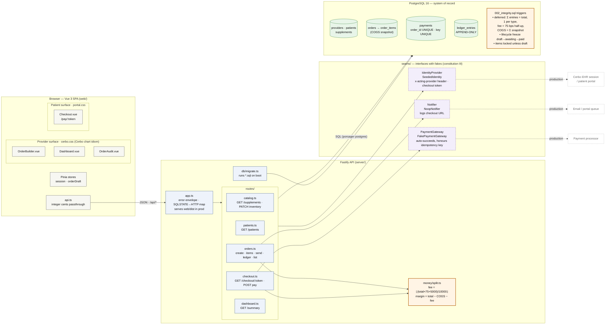
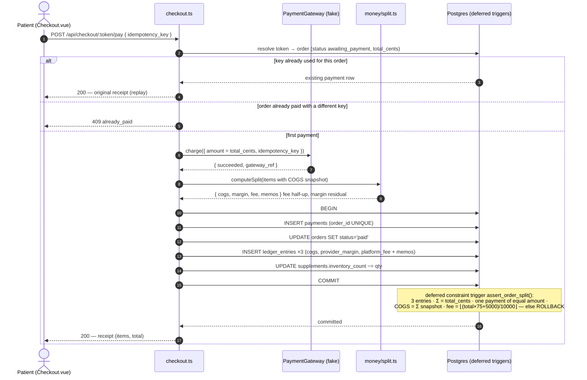
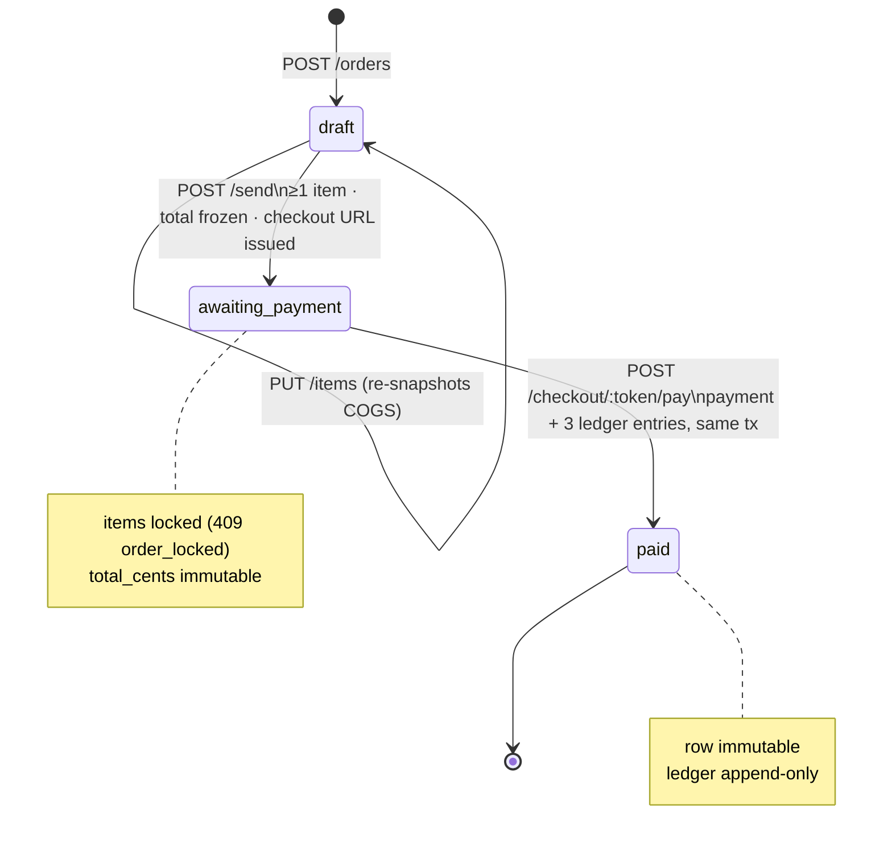
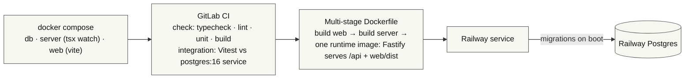

# Architecture

Vertical slice of an in-house supplement store that "lives inside" Cerbo's EHR. One Vue 3 SPA
with two visual surfaces, one Fastify REST API, one Postgres database that is the system of record
for money. Everything external is behind a documented seam with a fake implementation.

## System overview

## The money path (US2: patient pays)

One request, one database transaction, verified at commit by the database itself.

## Order lifecycle (enforced by `orders_guard_transition`)

## Deployment

## Where things live

| Concern | Location |
|---|---|
| Fee policy (75 bps half-up) | `server/src/money/split.ts` **and** `002_integrity.sql` §2f (cross-check, DECISIONS #8) |
| Sum invariant | `002_integrity.sql` `assert_order_split()` — deferred constraint trigger |
| Append-only ledger | `002_integrity.sql` §1 — trigger + REVOKE |
| COGS snapshot | `order_items_guard` trigger copies from catalog on insert (DECISIONS #9) |
| Stubbed boundaries | `server/src/seams/*.ts` — header comment on each states what is faked and what production does |
| Provider look | `web/src/styles/cerbo.css` per `docs/cerbo-ui-reference/DESIGN-NOTES.md` |
| Patient look | `web/src/styles/portal.css` |

PNGs are rendered from the Mermaid blocks above with `@mermaid-js/mermaid-cli`; the Mermaid source is canonical.

## Glossary

Domain and engineering terms used across the code, specs, and decision log.

**Money and accounting**

| Term | Meaning here |
|---|---|
| **COGS** (cost of goods sold) | What Cerbo paid for one unit of a supplement. Stored on the catalog as `unit_cogs_cents` and **snapshotted** onto each order line at assembly time, so later catalog changes never alter historical orders. |
| **bps** (basis points) | One hundredth of a percent. 75 bps = 0.75 % = 75 ⁄ 10 000. Used because fee schedules are quoted this way and it keeps the arithmetic in integers. |
| **Platform fee** | Cerbo's cut: 75 bps of the order total, computed once per order and rounded half-up. Borne by the provider's margin, so the patient pays sticker price. |
| **Provider margin** | What the provider earns: `total − COGS − platform fee`. Computed as the residual so the three parts always sum exactly. May be negative if the provider prices below cost. |
| **Split** | The three-way attribution of a paid order's total into COGS, provider margin, and platform fee. The graded heart of this project. |
| **Sum invariant** | The rule `COGS + provider margin + platform fee = amount paid`, with no exceptions. Enforced by the database at commit, not only by application code. |
| **Ledger / ledger entry** | The append-only table (`ledger_entries`) that records the split. One row per component per paid order. The system of record for money. |
| **Append-only** | Rows can be inserted but never updated or deleted. Enforced by a trigger and by revoked privileges. |
| **Compensating entry** | The only way to "correct" an append-only ledger: a new row that offsets an earlier one. Out of scope for this slice (no refunds), but the schema leaves room for it. |
| **Integer cents** | All money is stored and computed as whole cents in 64-bit integers (`BIGINT`, JS `number` guarded by `Number.isSafeInteger`). No floats, no decimal strings doing arithmetic. |
| **Half-up rounding** | When the exact fee lands on a fraction of a cent, .5 and above rounds up, below .5 rounds down. Implemented as `floor((total × 75 + 5000) / 10000)`. Example: 200 ¢ → 1.5 ¢ → 2 ¢. |
| **Memo** | A human-readable note stored on each ledger entry showing the computation, e.g. `75 bps of 7250¢ = 54.375¢ → 54¢ (half-up)`. Lets a reviewer audit the split without reading code. |
| **GMV** (gross merchandise value) | Total value of orders processed through the store. The brief's headline business metric; the dashboard's "gross" tile. |
| **Gross / margin / fees** (dashboard) | Sums over ledger entries: gross = Σ totals of paid orders, margin = Σ provider_margin entries, fees = Σ platform_fee entries. Computed from the ledger so they reconcile structurally. |

**Order flow**

| Term | Meaning here |
|---|---|
| **Order lifecycle** | `draft → awaiting_payment → paid`. Only these transitions exist. |
| **Draft** | Editable by the provider: items can be added, repriced, removed. No total yet. |
| **Awaiting payment** | "Sent" to the patient. Items and total are frozen; a checkout link exists. |
| **Paid** | Payment and ledger recorded. The order and its items are immutable. |
| **Frozen** | A column the database refuses to change after a given state (e.g. `total_cents` after send). |
| **Locked** | Same idea for whole rows: order items once the order leaves draft. The API returns `409 order_locked`. |
| **Snapshot** | A copy of a catalog value taken at a point in time and kept even if the catalog changes. Here: COGS on each order line. |
| **Default price** | The practice-level price on the catalog that pre-fills an order line. The provider can override it per line; the line is the source of truth. |
| **Checkout token / capability token** | A random, unguessable string on the order. Whoever holds the link can view and pay that one order. Stands in for a patient-portal session. |
| **Idempotency key** | A client-generated identifier sent with the pay request. Re-sending the same key returns the original result instead of charging twice. A different key on an already-paid order is rejected. |
| **Replay** | A repeated request with the same idempotency key (double-click, refresh, retry). Must be harmless. |
| **Receipt** | What the patient sees after paying: items and prices only. The margin breakdown is provider-facing. |

**Architecture and stubs**

| Term | Meaning here |
|---|---|
| **Seam** | A thin interface that separates this code from an external system, so the fake can be swapped for a real implementation without touching callers. Three here: identity, payment, notifier. |
| **Stub / fake** | The in-repo implementation of a seam that does the minimum to let the flow run (e.g. a payment gateway that always succeeds). |
| **Identity seam / EHR seam** | How the app learns who the acting provider is and which patient a link belongs to. Faked via an `x-acting-provider` header and the checkout token; production would use Cerbo's EHR session. |
| **Acting provider** | The provider the request is "logged in" as. Defaults to the first seeded provider. |
| **Notifier** | The seam that would email the patient their checkout link. The fake logs it; the UI shows the link instead. |
| **Payment gateway** | The seam that would charge the patient's card. The fake auto-succeeds and honours the idempotency key. |
| **Deferred constraint trigger** | A Postgres trigger that runs at transaction commit rather than per statement, so a multi-row rule (three ledger rows plus a payment plus an order status) can be checked once the whole set is in place. |
| **SQLSTATE** | Postgres's five-character error code. This project raises custom ones (`CB001`–`CB004`) so the API can map database rejections to HTTP statuses. |
| **Invariant** | A condition that must always be true of the data, regardless of which code path wrote it. |
| **Migration** | A numbered `.sql` file applied once, in order, on API boot. Schema, integrity triggers, and seed data each live in one. |
| **Seed data** | Demo rows (providers, patients, catalog) loaded by a migration so the app is usable with no setup. |
| **SPA** (single-page application) | The Vue front end: one HTML page, client-side routing, talks to the API over JSON. |
| **Cerbo chart idiom** | The provider-facing visual style copied from Cerbo's EHR: coloured panel headers, dense zebra tables, ledger-style billing block. See `docs/cerbo-ui-reference/`. |
| **Patient portal style** | The cleaner, simpler visual style used for the patient checkout surface. |

**Healthcare context**

| Term | Meaning here |
|---|---|
| **EHR** (electronic health record) | Cerbo's product: the system providers already work in. This store is designed to feel native to it. |
| **Provider** | A licensed clinician (physician, NP, etc.) who recommends supplements to patients. |
| **Functional medicine** | Cerbo's market: protocol-driven care where supplement recommendations are routine, which is why an in-house store makes sense. |
| **NPI** (National Provider Identifier) | A US 10-digit clinician ID. Present on the providers table for realism only; not validated. |
| **Cash pay** | Paid directly by the patient, not billed to insurance. Supplements here are cash-pay retail, which is why there is no claims or tax logic. |
