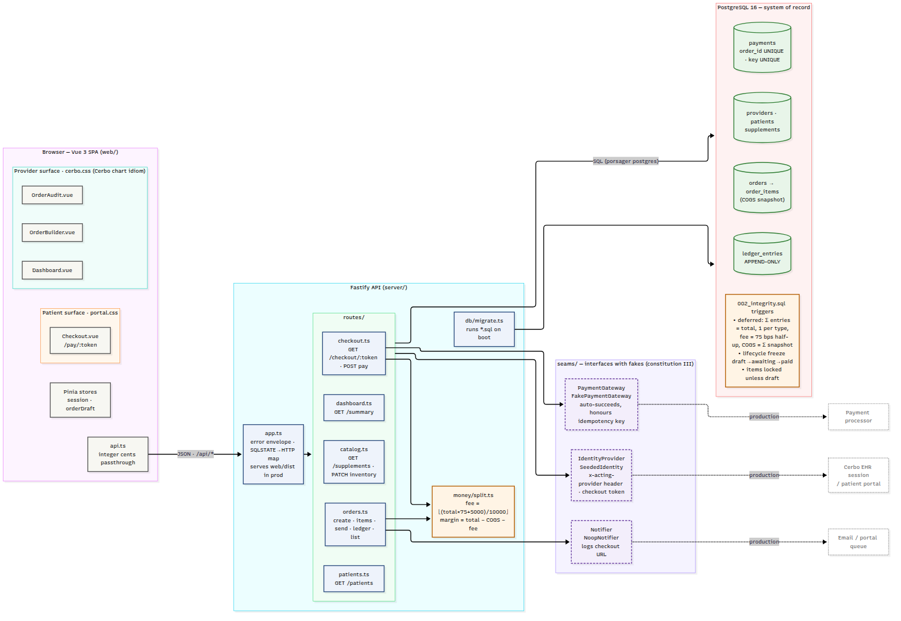
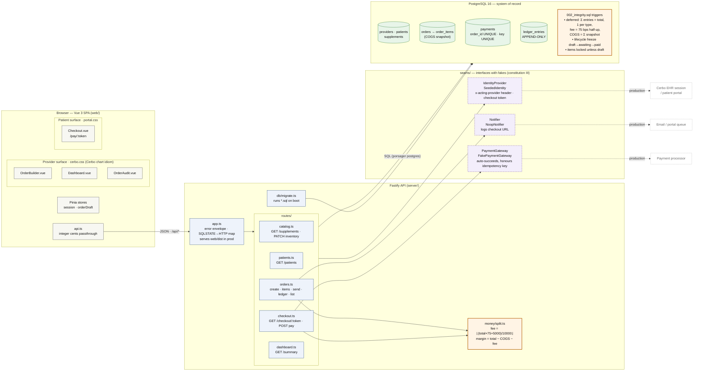
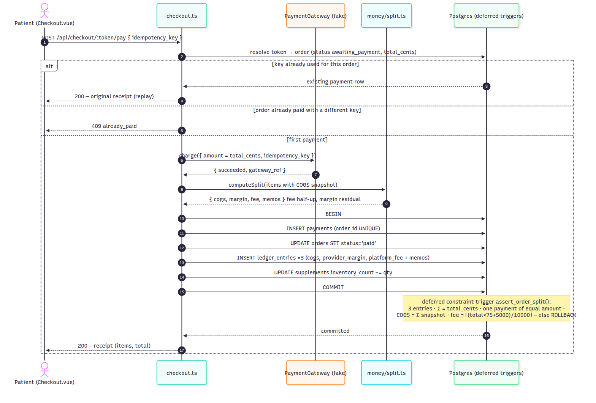
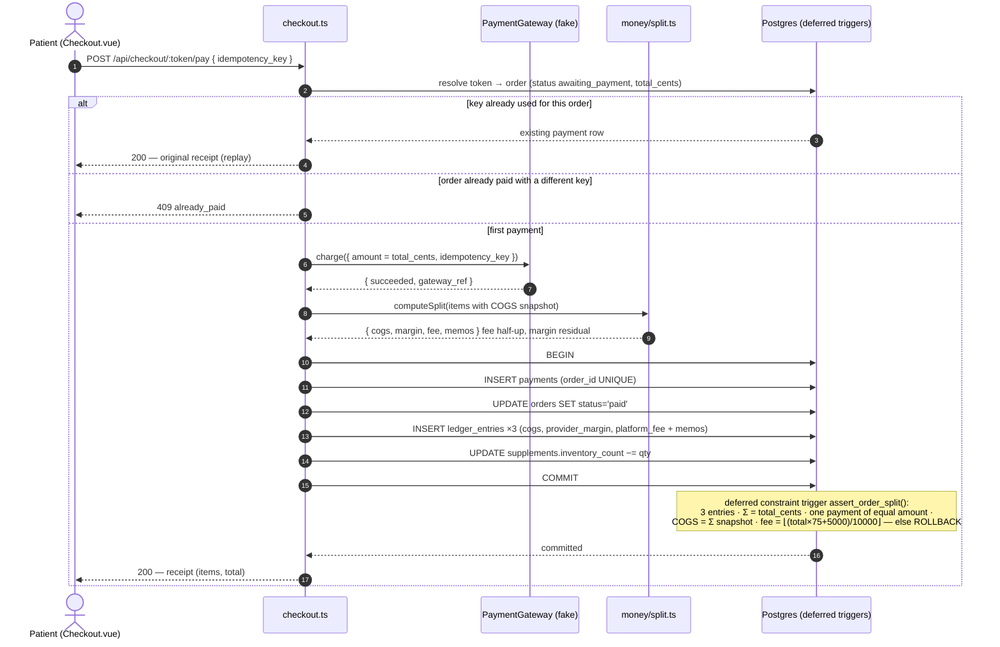
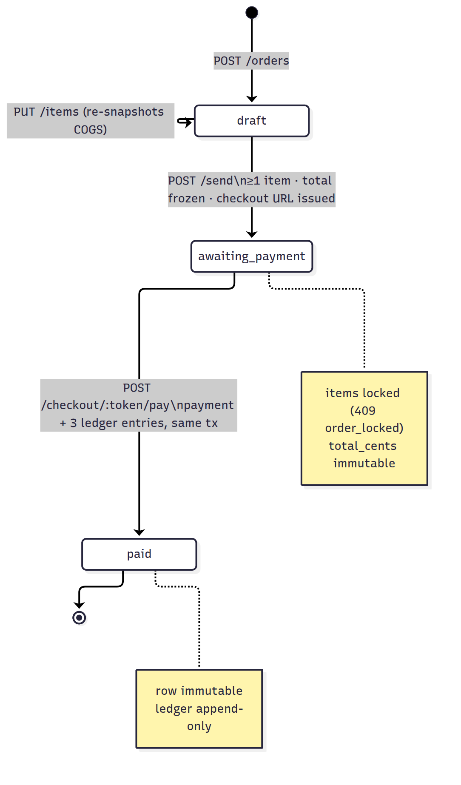
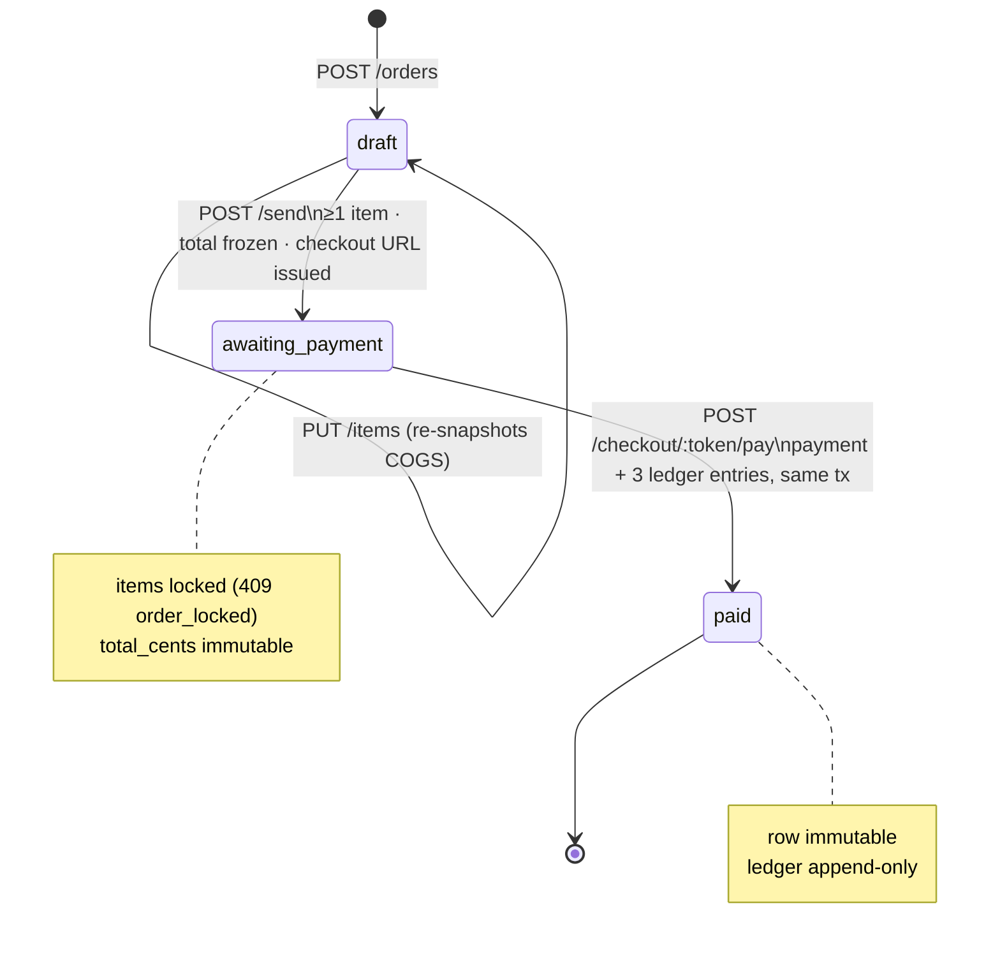
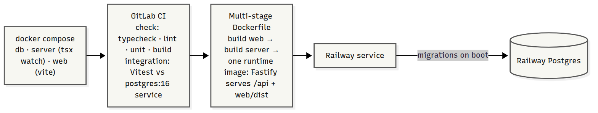
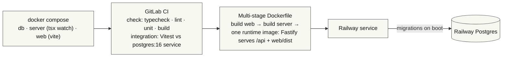

# Architecture

Vertical slice of an in-house supplement store that "lives inside" Cerbo's EHR. One Vue 3 SPA
with two visual surfaces, one Fastify REST API, one Postgres database that is the system of record
for money. Everything external is behind a documented seam with a fake implementation.

## System overview

## The money path (US2: patient pays)

One request, one database transaction, verified at commit by the database itself.

## Order lifecycle (enforced by `orders_guard_transition`)

## Deployment

## Where things live

| Concern | Location |
|---|---|
| Fee policy (75 bps half-up) | `server/src/money/split.ts` **and** `002_integrity.sql` §2f (cross-check, DECISIONS #8) |
| Sum invariant | `002_integrity.sql` `assert_order_split()` — deferred constraint trigger |
| Append-only ledger | `002_integrity.sql` §1 — trigger + REVOKE |
| COGS snapshot | `order_items_guard` trigger copies from catalog on insert (DECISIONS #9) |
| Stubbed boundaries | `server/src/seams/*.ts` — header comment on each states what is faked and what production does |
| Provider look | `web/src/styles/cerbo.css` per `docs/cerbo-ui-reference/DESIGN-NOTES.md` |
| Patient look | `web/src/styles/portal.css` |

PNGs are rendered from the Mermaid blocks above with `@mermaid-js/mermaid-cli`; the Mermaid source is canonical.
